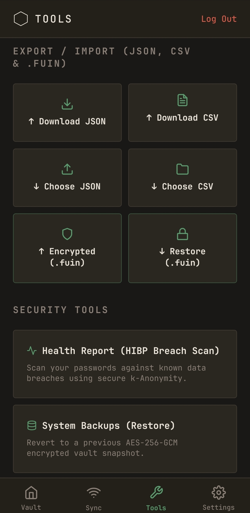

<div align="center">


# Fuin Mobile
**Quietly secure on the go.**

The Android companion app I built for [Fuin](https://github.com/Sombooo/Fuin)—also works standalone on your phone with zero cloud accounts.

[](https://www.gnu.org/licenses/agpl-3.0)
[](#)
[](https://github.com/Sombooo/Fuin)

</div>

<br />

<div align="center">
<table>
  <tr>
    <td align="center" width="50%">
      <br />
      <sub><b>Lock Screen (Zen Dark)</b></sub>
    </td>
    <td align="center" width="50%">
      <br />
      <sub><b>Vault — Cards, Logins & Notes</b></sub>
    </td>
  </tr>
  <tr>
    <td align="center" width="50%">
      <br />
      <sub><b>Warm Paper Theme</b></sub>
    </td>
    <td align="center" width="50%">
      <br />
      <sub><b>Encrypted Backups & Breach Check</b></sub>
    </td>
  </tr>
</table>
</div>

<br />

## Why I Built Fuin Mobile

When I built the desktop version of **[Fuin](https://github.com/Sombooo/Fuin)** to stop storing my logins in the cloud, I quickly ran into the practical downside: I still needed my passwords and 2FA codes on my phone. Running my own sync server felt like overkill, so I built **Fuin Mobile** instead.

You can use it purely as a standalone local vault on Android, or pair it with Fuin Desktop via QR code and sync updates back and forth over your own Wi-Fi or phone hotspot. No accounts, no servers, no analytics.

It's still in active beta—I use it daily and keep fixing rough edges as I find them.

---

## What It Includes

- **Offline Vault for Logins, Cards & Notes:** Store website credentials, payment cards (auto-formatted by card brand), and private secure notes encrypted locally on your device.
- **Direct LAN P2P Sync:** Pair once with Fuin Desktop by scanning an optical QR code, then sync diffs over local Wi-Fi or your hotspot using ephemeral **XChaCha20-Poly1305** encrypted packets.
- **Built-in 2FA & QR Scanner:** Save TOTP secrets (or scan `otpauth://` QR codes directly with your camera) and copy live 6-digit codes.
- **Native Android Autofill & Biometrics:** Fill logins inside Android apps and browsers through Android's native `AutofillService`, and unlock quickly with your fingerprint or face alongside your master password.
- **Health Check, Breach Scan & `.fuin` Backups:** Spot weak or reused passwords offline, optionally run a k-Anonymity check against HaveIBeenPwned, import CSV/JSON exports from Bitwarden/1Password/LastPass/Chrome, and create portable encrypted `.fuin` backups or local snapshots.

---

## How Security Works Underneath

Instead of vague claims, here is what protects your data on-device:

- **Argon2id Key Derivation:** Turns your master password into encryption keys directly on your phone using **Argon2id** (`64 MiB` memory, `3` iterations).
- **Authenticated Storage (`AES-256-GCM`):** Your vault and `.fuin` backups are encrypted with **AES-256-GCM**, failing safely if anything is tampered with.
- **Local-Only Network Sync (`XChaCha20-Poly1305`):** Sync packets use **XChaCha20-Poly1305**, per-request nonces, and strict `RFC1918` local-network validation so nothing goes out over the public internet.
- **Brute-Force & Screen Guards:** Enforces escalating lock delays after wrong password attempts, clears clipboard secrets automatically, and enables Android `FLAG_SECURE` screenshot protection in production builds.

You can read the details in [`SECURITY.md`](./SECURITY.md) and [`PRIVACY.md`](./PRIVACY.md).

---

## Running from Source

Fuin Mobile is built with **React Native** and **Expo**:

```bash
# Install dependencies
npm install

# Run static & crypto/sync interoperability tests
npm test

# Start the Metro bundler for development
npx expo start
```

---

## Support & Feedback

Fuin Mobile is independent open-source software licensed under **AGPLv3**. If you try it out and hit a bug or have an idea, issues and PRs are always welcome. And if you'd like to support the project, you can buy me a coffee below—thank you!

[](https://fuindev.lemonsqueezy.com/checkout/buy/c898c753-098b-4c0b-a721-77332db06bdc)
