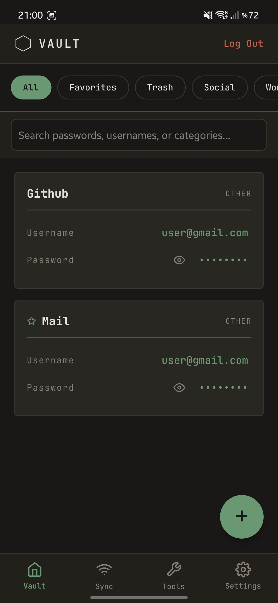
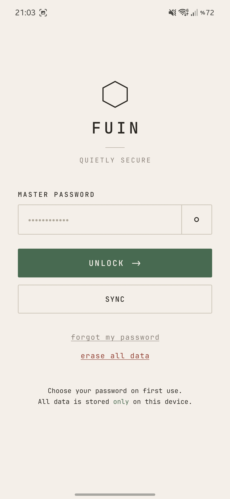
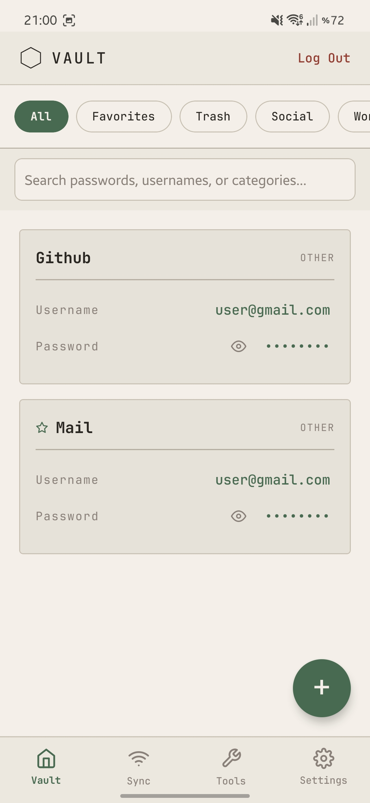
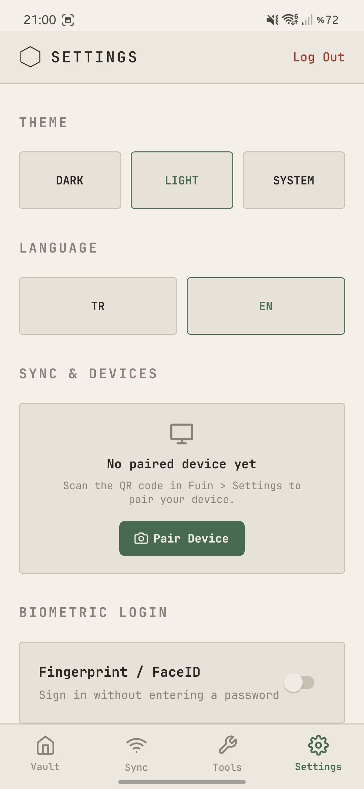

<div align="center">


# Fuin Mobile
**Quietly secure on the go.**

The mobile companion I built for the [Fuin](https://github.com/Sombooo/Fuin) local-first password and 2FA manager.

[](https://www.gnu.org/licenses/gpl-3.0)
[](#)
[](https://github.com/Sombooo/Fuin)

</div>

<br />

<div align="center">
<table>
  <tr>
    <td align="center" width="33%">
      <br />
      <sub><b>Zen Dark — Lock Screen</b></sub>
    </td>
    <td align="center" width="33%">
      <br />
      <sub><b>Zen Dark — Vault</b></sub>
    </td>
    <td align="center" width="33%">
      <br />
      <sub><b>Password Generator</b></sub>
    </td>
  </tr>
  <tr>
    <td align="center" width="33%">
      <br />
      <sub><b>Warm Paper — Lock Screen</b></sub>
    </td>
    <td align="center" width="33%">
      <br />
      <sub><b>Warm Paper — Vault</b></sub>
    </td>
    <td align="center" width="33%">
      <br />
      <sub><b>Settings & Pairing</b></sub>
    </td>
  </tr>
</table>
</div>

<br />

## Why I Built Fuin Mobile

When I built the desktop version of **[Fuin](https://github.com/Sombooo/Fuin)** to keep my passwords off the cloud, I still needed a practical way to access my logins on my phone without setting up a central server.

I created **Fuin Mobile** to work either as a standalone local vault on your phone or as a direct companion to the desktop app. Everything—decryption, password generation, 2FA codes, and sync merging—runs locally on your device.

---

## ✨ Features

- **Offline Vault:** Your passwords stay encrypted on your phone's local storage.
- **Private P2P Sync:** Pair once with Fuin Desktop via an optical QR code, then sync changes two-way over your local Wi-Fi or phone hotspot using **XChaCha20-Poly1305** encrypted packets with zero cloud relay.
- **Built-in 2FA (TOTP):** Generate 30-second 6-digit verification codes right inside your vault entries.
- **Biometric Unlock:** Unlock your vault quickly using Fingerprint or Face ID alongside your master password.
- **Password Health & Breach Check:** Check your passwords for weak or reused entries locally, or scan against known data breaches using HaveIBeenPwned's k-Anonymity range API.
- **Import & Encrypted Backups:** Import from **Bitwarden**, **1Password**, **LastPass**, or **Chrome/Edge** (CSV/JSON), and restore from local AES-256-GCM snapshots.

---

## 🔐 How It Protects Your Data

Instead of buzzwords, here is a straightforward summary of what happens under the hood:

- **Key Derivation:** Uses **Argon2id** (`64 MiB` memory, `3` iterations) to turn your master password into encryption keys on-device.
- **Vault Encryption:** Encrypts your stored vault with authenticated **AES-256-GCM**.
- **LAN & QR Transport:** Uses **XChaCha20-Poly1305** with per-request nonces and strict local-network (`RFC1918`) checks.
- **Brute-Force & Screen Protection:** Applies increasing cooldown delays after failed password attempts, blocks screenshots in production builds (`FLAG_SECURE`), and clears copied passwords automatically.

More details are available in [`SECURITY.md`](./SECURITY.md) and [`PRIVACY.md`](./PRIVACY.md).

---

## 🛠️ Running from Source

Fuin Mobile is built with **React Native** and **Expo**.

```bash
# Install dependencies
npm install

# Run static & crypto interoperability tests
npm test

# Start the Expo development server
npx expo start
```

---

## ☕ Support

Fuin is an independent open-source project licensed under the **GPLv3**. If you enjoy using it and want to support its development, you can buy me a coffee below:

[](https://fuindev.lemonsqueezy.com/checkout/buy/c898c753-098b-4c0b-a721-77332db06bdc)
