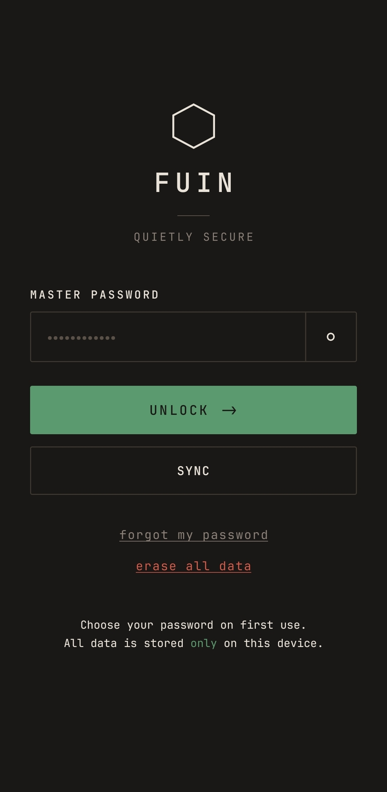
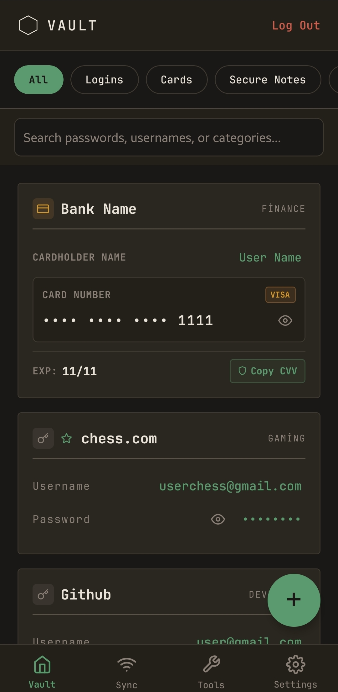
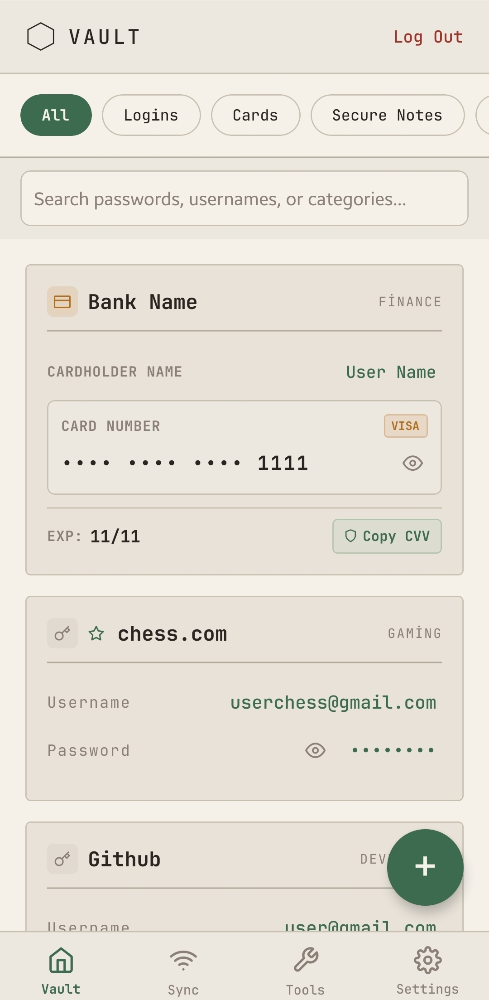

<div align="center">


# Fuin Mobile
**Quietly secure on the go.**

The Android companion app I built for **[Fuin](https://github.com/Sombooo/Fuin)**—works both synced with Desktop over local Wi-Fi and standalone on your phone with zero cloud servers.

[](https://www.gnu.org/licenses/agpl-3.0)
[](#)
[](https://github.com/Sombooo/Fuin)
[](https://fuindev.lemonsqueezy.com/checkout/buy/c898c753-098b-4c0b-a721-77332db06bdc)

</div>

<br />

## An Honest Note Before You Start

I built **Fuin Mobile** with the help of **AI coding tools** because after building [Fuin Desktop](https://github.com/Sombooo/Fuin), I still needed my passwords and 2FA codes on my phone without putting my vault in the cloud.

I'm a solo developer working on this in my own time, not a big security company. I test it daily and try to fix rough edges as quickly as I find them, **but** no software is perfect and it hasn't had a formal external audit yet. Because Play Store and Apple Developer accounts cost fees I can't put into this right now, APK builds are distributed directly through GitHub Releases (with SHA-256 checksums), and an iOS release isn't available yet.

<br />

<div align="center">
<table>
  <tr>
    <td align="center" width="50%">
      <br />
      <sub><b>Lock Screen (Zen Dark)</b></sub>
    </td>
    <td align="center" width="50%">
      <br />
      <sub><b>Vault — Cards, Logins & Notes</b></sub>
    </td>
  </tr>
  <tr>
    <td align="center" width="50%">
      <br />
      <sub><b>Warm Paper Theme</b></sub>
    </td>
    <td align="center" width="50%">
      <br />
      <sub><b>Encrypted Backups & Breach Check</b></sub>
    </td>
  </tr>
</table>
</div>

<br />

## What It Includes

- **Offline Vault for Logins, Cards & Notes:** Store website logins, formatted payment cards, and private notes encrypted locally on your device.
- **Direct LAN P2P Sync:** Pair once with [Fuin Desktop](https://github.com/Sombooo/Fuin) via an optical QR code, then sync edits back and forth over your own Wi-Fi or phone hotspot—no cloud accounts or relay servers.
- **Built-in 2FA & QR Scanner:** Save TOTP keys (or scan `otpauth://` QR codes with the camera) and copy live 6-digit codes.
- **Native Android Autofill & Biometrics:** Fill logins inside Android apps and browsers through Android's native `AutofillService`, and unlock with hardware-backed biometrics alongside your master password.
- **Master Password Change & Recovery Key:** Rotate your master password directly in Settings (updating biometric & recovery state cleanly) or restore access with your offline recovery key.
- **Breach Check, Importers & `.fuin` Backups:** Spot weak or reused passwords offline, optionally run a HaveIBeenPwned k-Anonymity check, import CSV/JSON from Bitwarden, 1Password, LastPass, or Chrome, and create portable encrypted `.fuin` backups.

---

## Technical Details & Running from Source

### Security Summary (Plainly Stated)
- **Argon2id KDF:** Derives encryption keys locally on-device using **Argon2id** (`64 MiB` memory, `3` iterations) via native bindings (`react-native-argon2`).
- **AES-256-GCM Storage:** The local vault and portable `.fuin` backups use **AES-256-GCM** with atomic file writes and `.bak` recovery snapshots.
- **Local LAN P2P (`XChaCha20-Poly1305`):** Sync packets use **XChaCha20-Poly1305**, per-request nonces, directional binding, strict dotted-decimal `RFC1918` IP validation, and disabled HTTP redirects.
- **Android Hardening:** Enforces `FLAG_SECURE` synchronously on launch, `android:allowBackup="false"`, `BIOMETRIC_STRONG` + `CryptoObject` on Autofill unlock, browser APK signing certificate checks, and native `EXTRA_IS_SENSITIVE` clipboard tagging + `AlarmManager` auto-clear.

More details are in [`SECURITY.md`](./SECURITY.md) and [`PRIVACY.md`](./PRIVACY.md).

### Running & Testing Locally

```bash
# Install dependencies
npm install

# Run static & unit tests
npm test

# Start the Metro bundler
npx expo start
```

---

## Support & Feedback

Fuin Mobile is open-source software under **AGPLv3**. If you test it out and find a bug or UX issue, opening an issue or PR helps a lot. And if it helps you and you feel like buying me a coffee, you can do so below.

Wishing you all happy days — and don't forget to drink some water and stay hydrated!

[](https://fuindev.lemonsqueezy.com/checkout/buy/c898c753-098b-4c0b-a721-77332db06bdc)
